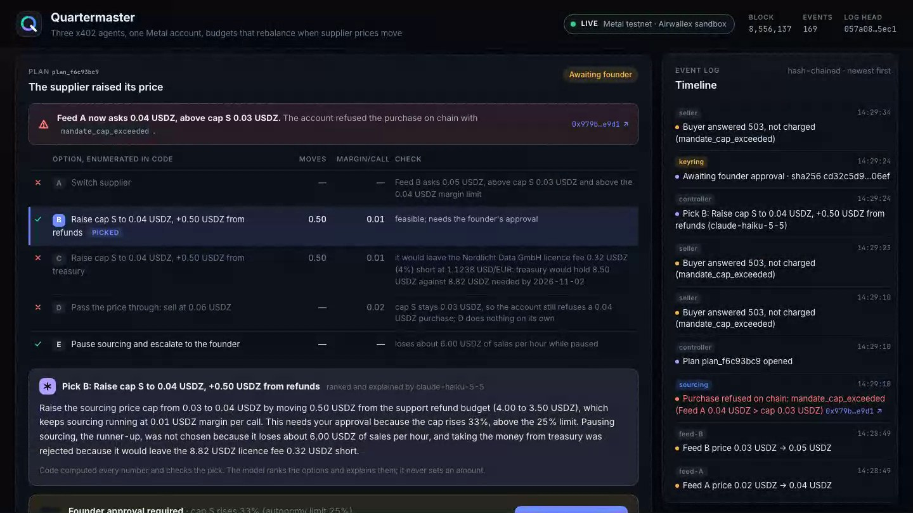
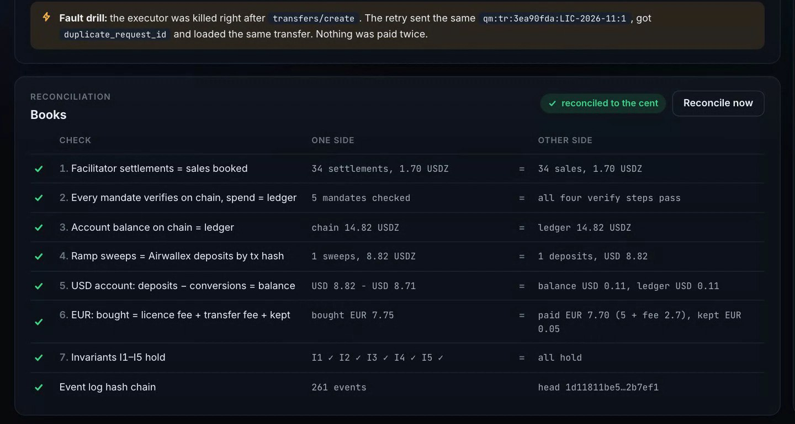
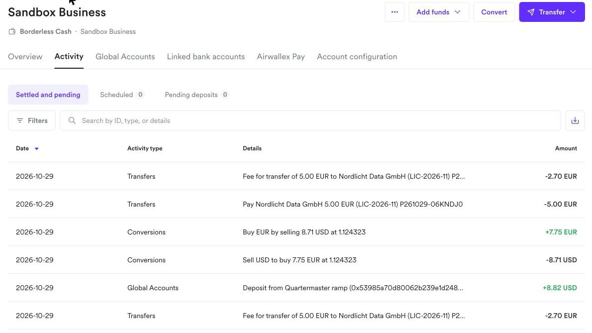
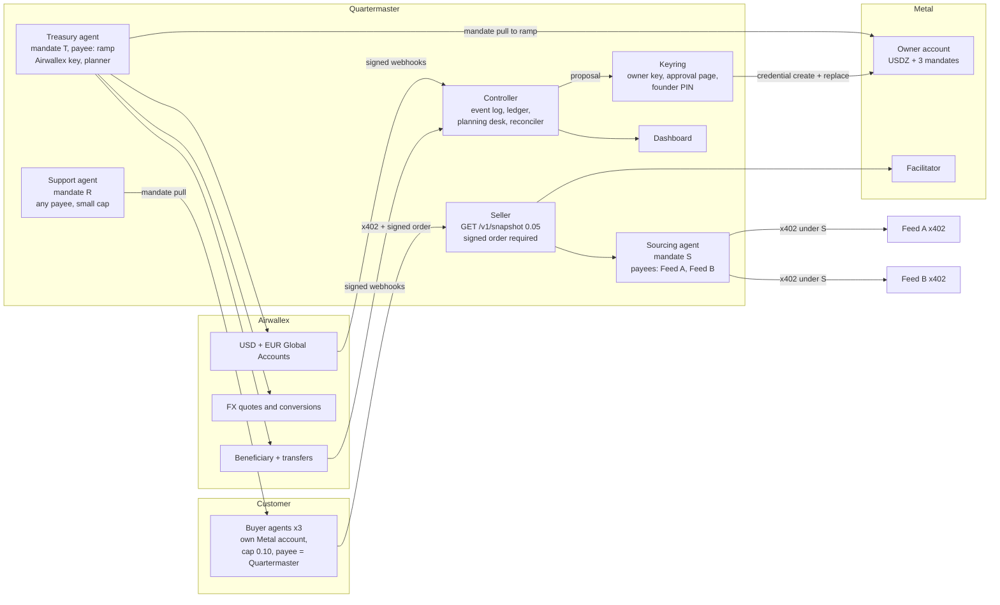

# Quartermaster

[](https://github.com/big14way/quartermaster/actions/workflows/ci.yml)

**Three x402 agents, one Metal account, budgets that rebalance when supplier prices move.**

**Demo video (4 min):** [youtu.be/9NyHmAIm7oc](https://youtu.be/9NyHmAIm7oc). It shows one live run on Metal testnet and the Airwallex sandbox; the run's full event log is [`runs/sample-live.jsonl`](runs/sample-live.jsonl).



Quartermaster runs a pay-per-call market data API with three AI agents that share one Metal account. Each agent spends under its own on-chain mandate:

- **sourcing** buys upstream quotes;
- **support** refunds buyers;
- **treasury** moves earnings to Airwallex and pays a EUR licence fee.

The three budgets always add up to the money the business set aside.

When a supplier raises its price past the sourcing cap, the account refuses the purchase on chain. Quartermaster then:

1. re-plans the split;
2. gets a human approval bound to the exact mandate change;
3. rewrites the mandates on chain, shrinking the donor before growing the receiver.

At the end, the books reconcile Metal against Airwallex to the cent.

The model proposes and explains. Code and the chain decide.

## For judges: Kit 11, step by step

Built for the Airwallex Agentic Banking Hackathon, **Kit 11: x402 Business Agents**, targeting the Metal Award. Each part of the kit's flow, with its proof from the live run:

| The kit asks to | What Quartermaster does | Proof from the live run |
|---|---|---|
| create your account, its three mandates, and a customer's account and mandate | The keyring creates the account and binds mandates S, R and T. A customer signs up with its own account and three buyer agents. | Account [created](https://testnet.metalntwx.com/tx/0xdba407f78aecfa2b4ac4ffabfd4285012adc67772d84183d1e2aaae838d4e01f) and [funded with 23 USDZ](https://testnet.metalntwx.com/tx/0x11467297b2228d38d79d56d0bb05ff29ee8fe49c885621e8c81a0a9193772f75) |
| run the upstream provider and a query route that requires a signed order | Feed A and Feed B sell quotes over x402. Quartermaster's paid route requires a signed order, and each sale buys a quote under mandate S. | 34 sales; the facilitator's settlements match the sales booked |
| raise the upstream price and show the refusal | Feed A goes from 2 to 4 cents. The account refuses the next purchase; buyers get a 503 and pay nothing. | [Refused on chain](https://testnet.metalntwx.com/tx/0x979befde0cd639b6988b383fe2ac693661fbf98eb1740736f30be434202fe9d1) with `mandate_cap_exceeded` |
| replace the mandates | Code computes the options, Claude Haiku explains the pick, the founder approves a hash-bound record, and the keyring replaces R, then S. | [R replaced](https://testnet.metalntwx.com/tx/0xa174c6f2efebf705a3724da4419fc9224456f0c5deeaecaa1a19c10b392c570c), [S replaced](https://testnet.metalntwx.com/tx/0x5507d52bae61c75b8f161842e3bceda1e7a24385da7706e9fb99a4ae584f6184) |
| resolve the disputed batch | Support checks each disputed signed order against its payment on chain and the delivery record. | 4 stale charges refunded under R, 1 rejected with evidence |
| move earnings to Airwallex and pay the licence fee | Treasury sweeps to the ramp under T. Airwallex books a USD deposit referenced by the sweep's tx hash, converts on a MIN_1 quote and pays EUR 5.00. | [Sweep](https://testnet.metalntwx.com/tx/0x53985a70d80062b239e1d24825001477d022876f3b600c3500d97306a6c3c1b4); payout PAID in the [Airwallex sandbox](#verified-on-metal-testnet) |

Beyond the kit, it also runs:

- **A compromised-agent drill.** The support agent's 10 USDZ payout to an outside address is [refused on chain](https://testnet.metalntwx.com/tx/0x0bffae6117cdf8d496c1ce3393527be77bba3bcbd1164436542743a0c5e8dc05).
- **A crash drill.** The executor is killed mid-payment, and the retry finds the same Airwallex transfer, so nothing is paid twice.
- **Seven reconciliation checks** that close Metal, the ledger and Airwallex to the cent.



### Run it in a minute

```
pnpm install
pnpm demo --headless      # the whole story in the terminal, offline, no keys
pnpm demo                 # the same story on the dashboard at http://127.0.0.1:4000
```

Offline mode needs no keys and labels every simulated surface. To run against Metal testnet and the Airwallex sandbox, see [Live](#live-metal-testnet-with-or-without-the-airwallex-sandbox).

---

## The story

The scenario follows the kit:

- The account holds **20 USDZ**, split across sourcing (10), support (4) and treasury (6). Against the real Airwallex sandbox it holds **23 USDZ** (10, 4, 9): the sandbox charges about EUR 2.70 to pay the invoice, not the kit page's EUR 0.15, so treasury needs 9.
- A query sells for **5 cents**. Its upstream data costs **2 cents**, under a **3 cent** cap.

| # | Step | What happens |
|---|---|---|
| 1 | **Accounts, mandates and the opening split** | The controller derives the split from first principles. Treasury gets the €5.00 licence fee plus the transfer fee at the live EUR/USD rate, plus a 2% buffer. Support gets more than the refund floor. Sourcing gets the rest. The keyring creates the account, funds it and binds three mandates. A customer business signs up with three buyer agents. The licence invoice is read and validated, including the IBAN checksum. |
| 2 | **Selling queries** | Buyer agents pay 5 cents a call over x402 with a **signed order**. For each sale, the sourcing agent buys a quote from Feed A under mandate S. Every sale is stored with its signed order, its tx hash and what was delivered. **Timeout drill** (offline, where the simnet can inject the fault): one upstream settlement comes back `settlement_in_doubt`. The agent treats it as unconfirmed and looks it up in the facilitator's `/settlements` by nonce, books it once and never pays again blind. Feed A then serves stale data for a few calls. |
| 3 | **Supplier raises its price** | Feed A goes to 4 cents and Feed B to 5. The sourcing agent reads the price from the 402 on every request. It refuses before signing, and records the refusal on chain (`mandate_cap_exceeded`). Buyers get a 503 and are **not charged**. Code enumerates options A–E with exact numbers, and the planner ranks them. |
| 4 | **Approval and mandate rewrite** | The founder approves on the keyring's own page with a PIN that only the keyring holds. The keyring rebuilds the approval record from live chain state and a fresh 402 probe, and refuses on any drift. It then replaces **R (donor) before S (receiver)**. Both mandates pass `mandate verify`, I1–I5 hold, and sourcing resumes at the new price. |
| 5 | **Disputed batch** | A buyer disputes five charges by tx hash. Support verifies each signed order against the payment on chain and checks the delivery record. It refunds the four stale ones under R, one payment id per refund, and rejects the fresh one with evidence. |
| 6 | **Earnings to Airwallex, licence fee paid** | Treasury sweeps to the ramp address under T, which can pay nobody else. It simulates a USD deposit whose `reference` is the sweep's tx hash, checking for an existing one first. It then takes a `MIN_1` quote, converts USD→EUR, and creates the transfer with `request_id`. **Fault drill:** the executor is killed after `transfers/create`. The retry gets `duplicate_request_id` and loads the same transfer, so nothing is paid twice. |
| 7 | **Compromised agent drill** | A compromised support agent tries to pay 10 USDZ to an outside address. The account refuses on chain with `mandate_cap_exceeded`, and the refusal is recorded. |
| 8 | **Books close** | Seven reconciliation checks (below) run, plus a verification of the event log's hash chain. |

How the planner decided in step 3 of the live run:

| Option | | Why |
|---|---|---|
| A. Switch to Feed B | ✗ | Feed B asks 0.05, above cap S 0.03 and above the 0.04 margin limit. |
| **B. Raise cap S to 0.04, +0.50 from refunds** | **✓** | Highest margin that leaves the refund floor intact. Needs approval because the cap rises 33%. |
| C. Raise cap S to 0.04, +0.50 from treasury | ✗ | It would leave the licence fee 0.32 USDZ (4%) short at the live rate. |
| D. Pass the price through | ✗ | Cap S stays 0.03, so the account still refuses the purchase. |
| E. Pause and escalate | ✓ | Always possible; loses about 6.00 USDZ of sales an hour. |

### Verified on Metal testnet

`runs/sample-live.jsonl` is a full live run against Metal testnet and the real Airwallex sandbox, with nothing simulated except what the sandbox itself simulates (the inbound deposit and the payout's progress). Replay it with `pnpm replay runs/sample-live.jsonl`. In that run:

- **Setup:** the account was [created](https://testnet.metalntwx.com/tx/0xdba407f78aecfa2b4ac4ffabfd4285012adc67772d84183d1e2aaae838d4e01f) and [funded with 23 USDZ](https://testnet.metalntwx.com/tx/0x11467297b2228d38d79d56d0bb05ff29ee8fe49c885621e8c81a0a9193772f75), split 10 / 4 / 9.
- **34 sales** were paid over real x402 with signed orders. Each one bought a real upstream quote under mandate S.
- **The 4 cent offer was [refused on chain](https://testnet.metalntwx.com/tx/0x979befde0cd639b6988b383fe2ac693661fbf98eb1740736f30be434202fe9d1)** under cap S.
- **The planner** (`claude-haiku-5-5`) picked option B.
- **The keyring replaced R, then S, on chain:**
  - [R replaced](https://testnet.metalntwx.com/tx/0xa174c6f2efebf705a3724da4419fc9224456f0c5deeaecaa1a19c10b392c570c)
  - [S replaced](https://testnet.metalntwx.com/tx/0x5507d52bae61c75b8f161842e3bceda1e7a24385da7706e9fb99a4ae584f6184), with spend carried over

  `mandate verify` passes for all of them.
- **Disputes:** support verified each disputed signed order against its payment on chain and refunded four stale charges.
- **Treasury:** it [swept 8.82 USDZ to the ramp](https://testnet.metalntwx.com/tx/0x53985a70d80062b239e1d24825001477d022876f3b600c3500d97306a6c3c1b4). Airwallex booked a USD 8.82 deposit with the sweep's tx hash as its reference. A MIN_1 quote then bought EUR 7.75 for USD 8.71, and the EUR 5.00 payout (fee EUR 2.70) went SENT, then PAID; EUR 0.05 stayed in the account. The executor was killed after `transfers/create`; the retry with the same `request_id` loaded the same transfer.
- **Drill:** the compromised support agent's 10 USDZ payout was [refused and recorded on chain](https://testnet.metalntwx.com/tx/0x0bffae6117cdf8d496c1ce3393527be77bba3bcbd1164436542743a0c5e8dc05).
- **Books:** all seven checks pass against the live facilitator, the chain and Airwallex, to the cent.

The same run in the Airwallex sandbox's own activity log, newest first: the ramp deposit (its reference is the sweep's Metal tx hash), the USD→EUR conversion, then the EUR 5.00 payment and its EUR 2.70 fee.



---

## Architecture



**Custody rules** (enforced by process boundaries, not by prompts):

- **Only the keyring holds the owner key.** It has no model in it, and it accepts two inputs:
  - the opening allocation, which it checks against the configured total itself (20 USDZ, or 23 against real Airwallex);
  - a proposal approved on its own page with the founder PIN.

  The controller and the planner can propose. They cannot approve.
- **Each agent is its own process with its own directory.** The directory holds only that agent's credential and P-256 mandate key. No agent can read another's key, and models never see a key.
- **The Airwallex API key lives only in the treasury agent.**
- **Mandates make the limits physical.** S can pay only the listed feeds, R refunds are capped per payment, and T can pay only the ramp. If an agent were fully compromised, it could still spend only inside its mandate (see step 7).

**Invariants**, checked before every plan, after every change and at the end:

| | Invariant |
|---|---|
| I1 | Σ budgets ≤ the allocation (20 USDZ, or 23 against real Airwallex), and Σ remaining ≤ balance − gas reserve. The account caps each budget; the sum is ours to enforce. |
| I2 | Treasury's remaining budget covers the licence fee at the live rate plus buffer. |
| I3 | Support's remaining budget stays above the refund floor (P95 refunds/h × runway × price). |
| I4 | Never buy above what we sell for: cap S ≤ sell price − minimum margin. |
| I5 | Each role has exactly one live mandate, and a replace references the current one. |

**Approval binding.** The approval is a canonical JSON record (sorted keys, SHA-256). It holds:

- the plan and option;
- every mandate change, old → new;
- the amount moved and the counterparty;
- the invoice reference;
- evidence: the 402 offer hash and price, the refusal tx, the balance, the spend per role, and the FX rate when treasury is touched;
- the planner's explanation and an expiry.

The approval page shows exactly these fields. Before sending anything, the keyring rebuilds the record from live state. If the price moved, the balance or a spend changed, a mandate was replaced or the approval expired, it refuses and names what drifted. The controller then re-plans.

**Idempotency.**

- **Airwallex `request_id`s** are `qm:cv:{run}:{invoice}:{attempt}` and `qm:tr:{run}:{invoice}:{attempt}`, at most 47 characters. `{run}` is the end of the run's Metal account address, because a sandbox account outlives runs and refuses a used id forever. They are retried only for conversions and transfers, and always with the same id:
  - `duplicate_request_id` loads the existing object;
  - `409 request_pending` backs off.
- **The deposit's idempotency key is the sweep tx hash.** The treasury agent scans `GET /deposits` for it before creating one.
- **Metal payouts use one `--payment-id` per refund or sweep**, so a re-run pays at most once.
- **Seller deliveries are keyed on `settlement.first`.**
- **Every ledger entry is unique by `(source, external_id)`.**

**Books.**

- **Double-entry ledger** in integer cents (bigint) on SQLite. USDZ is converted to 18-decimal base units only at the Metal boundary; Airwallex amounts are parsed losslessly.
- **Webhooks** are verified with HMAC over `x-timestamp + raw body`, deduplicated by event id, acknowledged before processing, and applied through a monotonic transfer-status guard. FAILED overrides PAID; late webhooks are ignored and shown on the dashboard.
- **A poller** folds in the same Airwallex state, so lost webhooks never stall the books.

**Reconciliation checks:**

1. Facilitator `/settlements` to our account = sales booked.
2. Every mandate, current and replaced, passes `mandate verify`, and its on-chain spend = ledger spend.
3. On-chain account balance = ledger.
4. Σ ramp sweeps (USDZ) = Σ settled Airwallex deposits whose reference is a sweep tx (USD, 1:1).
5. USD deposits − conversion sells = change in the USD balance since setup = ledger.
6. EUR bought = paid out (licence fee + transfer fee) + change in the EUR balance since setup; the transfer is PAID; licence payable = 0.
7. I1–I5 hold.

Checks 5 and 6 measure from the balances recorded at setup, because a sandbox account outlives a run and comes with seeded balances. Neither balance may end below where it started: a run spends only what it brought in. Treasury buys the fee estimate plus the FX buffer, because the sandbox's EUR fee moves with the rate, so a few cents can stay in the EUR account.

On top of these, the event log's hash chain must verify.

**Event log and replay.** Every event goes into `runs/<id>.jsonl`. Each line carries the previous line's hash, so editing or dropping any line breaks the chain. Model inputs are hashed and their outputs are recorded, so replays never call the API.

---

## Claude

- **Planner** (`claude-haiku-5-5` by default): the treasury agent sends it the option table, with every number already computed. It returns a pick, a ranking and a plain-language explanation for the approver, as structured output. The policy engine accepts the pick only if it is an enumerated, feasible option and its numbers match exactly. Otherwise a deterministic rule picks the highest-margin feasible option.
- **Extraction** (`claude-haiku-5-5` by default): reads the supplier invoice into strict fields and reads dispute claims. Code validates the invoice (IBAN mod-97, currency, amount, date) and decides every refund.
- **Models** are set by `QM_PLANNER_MODEL` and `QM_ASSIST_MODEL`. Server-side refusal fallbacks are sent only to models that have them (Opus, Sonnet, Fable); on Haiku a refusal falls to the rule-based path.
- **Without `ANTHROPIC_API_KEY`**, rule-based paths run instead, and the dashboard says which source made each decision.

---

## Running it

Requirements: Node 22.13+ (for `node:sqlite`) and pnpm 10.

### Offline (no keys)

```bash
pnpm install
pnpm demo                 # dashboard at http://127.0.0.1:4000; the terminal prints the founder PIN
pnpm demo --headless      # the whole story, approvals included, exits 0 if the books reconcile
pnpm replay runs/sample-offline.jsonl            # verify and re-narrate a recorded run
pnpm replay runs/sample-offline.jsonl --serve    # the dashboard on that recording
```

Offline mode runs two local stand-ins. Both are labelled **SIMULATED** in the UI.

- **Metal simnet** (`packages/sim/src/simnet`):
  - USDZ balances, and owner accounts that hold mandates;
  - P-256 mandate keys and issuer-signed credentials;
  - the account-side checks with Metal's refusal codes;
  - replace (spend carries over) and recorded refusals;
  - a facilitator with `/verify`, `/settle` (`settlement.first`) and `/settlements`;
  - a tiny explorer.
- **Airwallex simulator** (`packages/sim/src/awx`):
  - the same REST paths and shapes Quartermaster calls;
  - `request_id` duplicates;
  - MIN_1 quotes and transfer transitions;
  - a kept fee on a bounce;
  - signed webhooks delivered out of order.

Both sides use the same interfaces as the live adapters. The Airwallex client is the same code in both modes; only the base URL changes.

### Live (Metal testnet, with or without the Airwallex sandbox)

The Metal side runs live on testnet with no console account. You buy an RPC endpoint over x402, the way an agent would. `ma` below is `metal-agent` (installed as a workspace dependency):

```bash
ma() { HOME=$PWD/.metal node packages/metal/node_modules/@metalntwx/metal-agent/dist/index.js "$@"; }
ma key create --out .metal/rpc-payer.json                  # .metal/ is gitignored
ma fund <address> --network testnet                        # 100 testnet USDZ from the faucet
ma pay https://rpc-testnet.metalntwx.com/v1 --network testnet --key .metal/rpc-payer.json \
  --method POST --body '{"jsonrpc":"2.0","id":1,"method":"eth_blockNumber","params":[]}'
# the rpc-aas-endpoint header is your METAL_RPC_URL; GET-paying it again tops up $1
ma key create --out .metal/ramp.json                       # stands in for the Airwallex on-ramp
```

Then fill in `.env` (copy `.env.example`):

| Variable | Value |
|---|---|
| `METAL_RPC_URL` | the endpoint from the `rpc-aas-endpoint` header. It is a credential. |
| `QM_FUNDER_KEY` | `.metal/rpc-payer.json`. Setup is paid by exact USDZ transfers from this key instead of the faucet, which allows one grant a minute and ten a day per IP. A run uses about 29 testnet USDZ. |
| `QM_RAMP_ADDRESS` | the address of `.metal/ramp.json` |
| `AIRWALLEX_CLIENT_ID`, `AIRWALLEX_API_KEY` | sandbox keys. Leave them empty to keep Airwallex on the simulator, which every surface labels. A scoped key on the account needs read on Balances and Deposits, read and write on Global Accounts, Beneficiaries, Transfers and Conversion, and write on Simulations. |
| `QM_TRANSFER_FEE_EUR` | the payout fee to budget for against real Airwallex. The sandbox charges EUR 2.69 to 2.70 for a LOCAL payout to a DE IBAN, depending on the rate, not the kit page's EUR 0.15, so set `2.69`. Treasury buys it plus a 2% buffer and gets about 9 USDZ instead of 6. |
| `QM_ALLOCATION_USDZ` | the total the three budgets share against real Airwallex. Set `23`, so sourcing keeps its 10 next to treasury's 9 and the price-rise step can still move 0.50 USDZ from refunds. With 20, sourcing gets 7 and the planner correctly pauses and escalates instead. |
| `ANTHROPIC_API_KEY` | optional. The planner and extraction use `claude-haiku-5-5`. |

Run `pnpm live:check` to drive a throwaway account through every CLI command Quartermaster parses, then `pnpm demo --live` (add `--headless` to run the whole story). Airwallex webhooks are optional, because the poller covers them. To receive them, point a public tunnel at `POST /webhooks/airwallex` and set `AIRWALLEX_WEBHOOK_SECRET`.

In live mode:

- The seller and the feeds use `@x402/express` with `registerMetalScheme`, plus `requireSignedOffer` on the seller route.
- Agents pay with `metal-agent pay --mandate`.
- Refunds and sweeps use `metal-agent mandate pull` with a `--payment-id`.
- The keyring uses `mandate credential create --mandate-key-file` and `mandate replace`.
- Support verifies signed orders with `verifyMandatePayment`.

---

## Repository

```
apps/
  agents/       sourcing, support, treasury: one process per agent (src/main.ts <role>)
  keyring/      owner key, opening allocation, approval page, mandate replace
  controller/   event log, ledger + webhooks, planning desk, reconciler, story director, API
  seller/       Quartermaster's paid route; stores signed orders and deliveries
  feeds/        Feed A and Feed B, upstream x402 sellers with price and quality controls
  buyers/       the customer: its own account and three buyer agents
  dashboard/    Vite + React UI served by the controller
  sim/          hosts the Metal simnet and the Airwallex simulator offline
packages/
  core/         bigint cents, canonical JSON + SHA-256, request ids, hash-chained event log, kit config
  ledger/       double-entry ledger and document store on node:sqlite
  airwallex/    REST client: token cache, rate limits, lossless JSON, idempotent creates, FX orientation,
                transfer status guard, webhook HMAC
  metal/        OwnerRail / AgentRail interfaces, metal-agent CLI adapter, x402 offers, live paywall
  sim/          Metal simnet and Airwallex simulator behind the same interfaces
  policy/       invariants I1–I5, options A–E, fallback rule, approval records and drift checks
  planner/      Claude planner and extraction, recorded for replay
  runtime/      mode switch, file layout, HTTP helpers, event reporting
scripts/        demo supervisor, replay, live check
runs/           event logs; sample-live.jsonl is the live run in the video, sample-offline.jsonl an offline run
```

Tests: run `pnpm test` and `pnpm test:e2e`. CI runs both on every push.

- `pnpm test` runs 49 unit tests: money, hashing, event ordering, the ledger, the Airwallex client and the simulators, the policy math and approval drift, webhook dedupe, the late-status guard and FAILED-after-PAID reversal.
- `pnpm test:e2e` runs the whole offline story, which must reconcile.

## Licence

MIT
